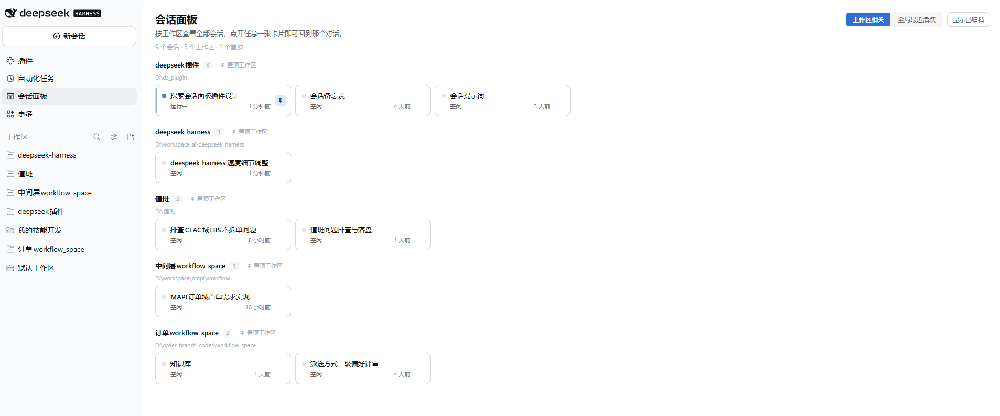

# dsh-session-panel

A session panel for [DeepSeek Harness](https://github.com/deepseek-ai/deepseek-harness) (`dsh`): one sidebar row, one screen of cards, one click back into the conversation.

English | [中文](README.zh.md)



## What it does

The sidebar gains a **Session panel** row, directly below the shipped **Automation tasks** row. It has two view modes, switched from the top right.

### By workspace (default)

Sessions grouped under the workspace that owns them, each section carrying its count and directory:

- **Status at a glance.** A dot and a label per card: running, waiting for approval, plan awaiting review, waiting for an answer, just finished, or idle. A pending interaction outranks running, which outranks the finished-but-unopened reminder.
- **Pinning reorders, it does not extract.** A pinned Session leads inside its section, and a pinned workspace lifts the whole section. Sessions never leave the section they belong to — pulling them out would render one workspace twice and break the grouping.
- **Ordered for triage.** A workspace holding pinned work leads, then the best tier it contains, then recency.

### Recent everywhere

One flat list across all workspaces:

- Pinned Sessions rise into a **Pinned** block above a rule; everything below it is the rest.
- Each card carries its workspace as a small tag, because in a flat list the Sessions of one workspace scatter.
- No grouping headers.

### Ordering, in both modes

One shared rule:

| Tier | What |
|---|---|
| 0 | pinned **and** busy |
| 1 | pinned |
| 2 | busy |
| 3 | idle |

Within a tier, most recently active first. Pinned-and-busy is the only top tier, so a pinned Session that is running leads a pinned Session that is idle even when the idle one was touched later.

### Pinning

Two pin sources, deliberately kept apart:

- **Session pins** use the Harness's own `pinSession` / `pinnedSessionIds`. They are the same fact as a pin in the sidebar, so this panel stores no second copy.
- **Workspace pins** have no Harness equivalent, because `WorkspaceView` carries no pin field. They are stored in `~/.dsh/plugin-data/dsh-session-panel.json` and follow the **folder path**, not the title: a rename keeps the pin, and a folder that is removed and re-added gets its pin back.

Both are driven from the panel — the pin glyph on a card, and the pin button beside a workspace heading. A card whose workspace is pinned as a whole shows the pinned state but cannot be unpinned on its own.

- **Archived sessions stay out of the way.** Hidden by default; a toggle brings them back, greyed and marked. An archived card is never pinned and cannot be opened until restored.
- **Nothing extra is spent.** Everything comes from state the client already holds. No model call, no extra token.

Long workspaces fold their overflow behind an "N more" control instead of pushing the page down.

## Install

```sh
dsh plugin add dsh-session-panel
```

Or from a checkout:

```sh
dsh plugin --profile web add /path/to/dsh-session-panel
```

Reload the page afterwards. The row appears below Automation tasks, and the panel opens in the main column.

## What it does not do

- No creating, renaming, archiving or deleting sessions.
- No sending prompts, steering, or stopping a turn.
- No per-session token, cost or context-usage figures.
- No full-text search across sessions.
- No floating orb or right-sidebar surface.

Those are natural next steps, not oversights.

## How it works

| Slot | Purpose |
|---|---|
| `sidebar.panellist` | The sidebar row. `order: 11` puts it directly below Automation tasks at `order: 10`. |
| `main` (keyed `session-panel`) | The page. The sidebar row selects the same key. |

Session, workspace and status data come from the framework's standard root-scope props — `useSessions`, `useWorkspaces` and `useSessionStatus` — so the page subscribes to the slices it needs and the Harness renderer handles incremental publication.

Workspace pins need the filesystem, which the browser cannot touch, so the host half exposes three **loopback-only** routes:

| Route | Purpose |
|---|---|
| `GET /dsh-session-panel/state` | The current pin set |
| `POST /dsh-session-panel/pin` | `{ path, pinned }` |
| `POST /dsh-session-panel/reload` | Re-read the file after a repair |

Every route refuses any peer that is not on `127.0.0.0/8` or `::1`, and does so before checking the method, so a remote caller learns nothing about the contract. A missing or unparsable address fails closed.

The pin file is written atomically (temp file plus rename) and one write at a time. A missing file is a clean first run. A **damaged** file is reported and **refuses every write** — overwriting it with the in-memory empty state would destroy the only copy of the user's pins; the panel shows a notice with a retry that re-reads after the user repairs it.

Styling uses only `--dsw-*` theme tokens, with one local pair for the pin accent (the palette has no soft blue chip). The stylesheet is a component-local element, removed on unmount.

## Requirements

- DSH `0.2.2-rc.3` or a compatible `0.2.x`. Developed and verified against `0.2.2-rc.3`.
- The web client (`dsh.client.platform: web`).

## Development

```sh
npm test
```

Four suites:

- `test/panel.test.js` — the derivation: the four-tier ordering, both modes, the two pin sources, grouping, and the registration contract.
- `test/render.test.js` — renders the shipping components with real React for both modes, pinned and unpinned states, the rule, the workspace tag, archived rows, and a damaged pin file. It resolves React from a scratch install; point `DSH_RENDER_TEST_NODE_MODULES` at one if the default is missing.
- `test/host.test.js` — the file and the routes against a real temporary directory: atomic writes, first-run absence, a damaged file refusing writes, reload recovery, serialized concurrent writes, and the loopback guard.
- `test/discovery.test.js` — the install contract: a resolvable name, `dsh.bundle`, `dsh.client` with `platform: web`, a `./client` export that exists, an envelope id equal to the package name, no unexpected externals, and parseable locales.

## License

MIT. Copyright (c) 2026 gznofeng.
