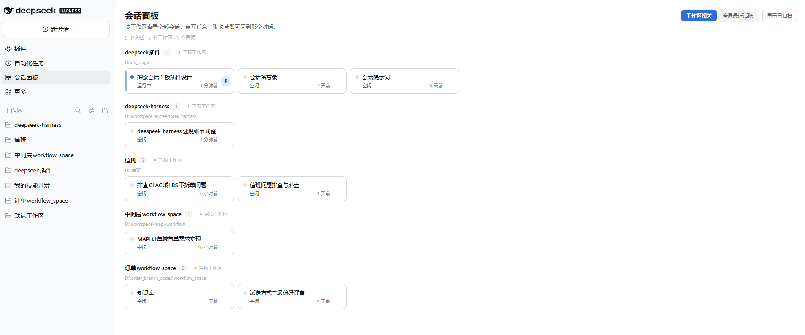

# dsh-session-panel

给 [DeepSeek Harness](https://github.com/deepseek-ai/deepseek-harness)（`dsh`）加一个会话面板：左侧栏一行，两种视图，会话与工作区都能置顶，点一下回到对话。

[English](README.md) | 中文



## 它做什么

左侧栏多出一行 **会话面板**，就排在官方的 **自动化任务** 下面。右上角可以在两种视图之间切换。

### 工作区相关（默认）

按拥有它的工作区分组，每个区块带会话数量与目录：

- **状态一眼看清。** 每张卡片一个状态点和一句标签：运行中、等待批准、等待计划评审、等待回答、刚完成、空闲。等用户处理的交互高于运行中，运行中高于「跑完了但还没看」。
- **置顶只调顺序，不把会话抽走。** 置顶的会话在组内排最前，整个工作区置顶则整组提前。会话永远不会离开它所属的区块——抽出去会让同一个工作区在页面上出现两次，破坏分组本身的意义。
- **为快速判断排序。** 含置顶内容的组在前，其次是组内最好的档位，最后按活跃时间。

### 全局最近活跃

全部工作区的单一扁平列表：

- 置顶的会话升到分隔线以上的 **置顶** 区，线以下才是其余。
- 每张卡片带一个工作区小标签，因为扁平之后同一工作区的会话会散落各处。
- 没有分组标题。

### 排序规则（两种视图共用）

| 档位 | 内容 |
|---|---|
| 0 | 置顶 **且** 忙 |
| 1 | 置顶 |
| 2 | 忙 |
| 3 | 空闲 |

同档内按最后活跃时间倒序。「置顶且忙」是唯一的最高档，所以一个正在跑的置顶会话会压过一个空闲的置顶会话——哪怕后者更晚才动过。

### 置顶

两个来源，刻意分开：

- **会话置顶** 用 Harness 自己的 `pinSession` / `pinnedSessionIds`。它和侧边栏的置顶是同一件事，所以本插件不另存一份。
- **工作区置顶** 在 Harness 里没有对应物（`WorkspaceView` 没有 pin 字段），存在 `~/.dsh/plugin-data/dsh-session-panel.json`，跟着**文件夹路径**走而不是标题：改名不丢置顶，文件夹移除了再加回来，置顶状态也还在。

两者都在面板里操作——卡片上的图钉、工作区标题旁的置顶按钮。工作区已整体置顶时，组内单卡会显示为已置顶但不可单独取消。

- **已归档的不碍事。** 默认隐藏；顶部开关展开，置灰并标注。归档卡片永远不会被置顶，恢复之前也打不开。
- **不产生额外开销。** 全部来自客户端已有状态。不调模型、不额外消耗 token。

会话多的工作区会把多出来的折进「还有 N 个」，不会把页面拉长。

## 安装

```sh
dsh plugin add dsh-session-panel
```

或从本地目录安装：

```sh
dsh plugin --profile web add /path/to/dsh-session-panel
```

装完刷新页面。那一行出现在「自动化任务」下面，点开就在主区域打开面板。

## 它不做什么

- 不新建、不重命名、不归档、不删除会话。
- 不发消息、不插话、不停止正在跑的回合。
- 不显示每个会话的 token、费用或上下文占用。
- 不做跨会话全文搜索。
- 不做悬浮球，也不占用右侧栏。

## 怎么实现的

| 插槽 | 作用 |
|---|---|
| `sidebar.panellist` | 左侧栏那一行。`order: 11` 正好排在 `order: 10` 的自动化任务下面。 |
| `main`（key 为 `session-panel`） | 面板页面。左侧栏那一行选中的就是这个 key。 |

会话、工作区与状态数据来自框架提供的根作用域标准属性——`useSessions`、`useWorkspaces`、`useSessionStatus`——因此页面只订阅它需要的切片，增量刷新由 Harness 渲染层负责。

工作区置顶需要碰文件系统，浏览器做不到，所以 Host 端暴露三条**仅回环**路由：

| 路由 | 作用 |
|---|---|
| `GET /dsh-session-panel/state` | 当前置顶集合 |
| `POST /dsh-session-panel/pin` | `{ path, pinned }` |
| `POST /dsh-session-panel/reload` | 手工修好文件后重读 |

三条路由都会拒绝任何不在 `127.0.0.0/8` 或 `::1` 上的对端，而且**先检查地址再检查方法**，远端调用者连路由的契约都探不到。地址缺失或无法解析时按「非本机」处理。

置顶文件是**原子写**（临时文件 + rename），并且一次只写一笔。文件不存在是干净的首跑；文件**损坏**时会报错并**拒绝一切写入**——拿内存里的空状态覆盖它，会毁掉用户置顶的唯一副本；面板会显示提示和「重试」，等用户修好后重读。

样式只用 `--dsw-*` 主题变量，只有置顶强调色是本地的（主题色板里没有这种浅蓝）。样式表是组件内的元素，卸载即移除。

## 运行要求

- DSH `0.2.2-rc.3` 或兼容的 `0.2.x`。在 `0.2.2-rc.3` 上开发和验证。
- Web 客户端（`dsh.client.platform: web`）。

## 开发

```sh
npm test
```

四个测试套件：

- `test/panel.test.js` —— 推导逻辑：四档排序、两种视图、两个置顶来源、分组、注册契约。
- `test/render.test.js` —— 用真实 React 渲染实际发布的组件，覆盖两种视图、置顶与未置顶、分隔线、工作区标签、归档行、损坏的置顶文件。React 从一份临时安装解析；默认路径不存在时用 `DSH_RENDER_TEST_NODE_MODULES` 指过去。
- `test/host.test.js` —— 在真实临时目录上测文件与路由：原子写、首跑缺席、损坏文件拒绝写入、重读恢复、并发写串行化、回环守卫。
- `test/discovery.test.js` —— 安装契约：可解析的包名、`dsh.bundle`、声明 `platform: web` 的 `dsh.client`、真实存在的 `./client` 导出、与包名一致的 envelope id、没有意外的外部依赖、locale 可解析。

## 许可

MIT。Copyright (c) 2026 gznofeng。
